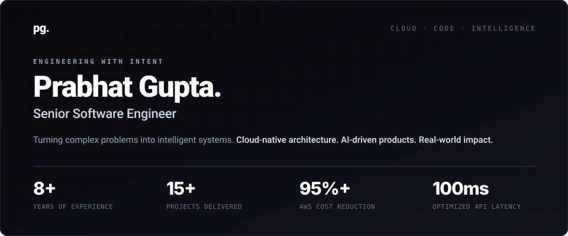

  

 

### `01 / ABOUT ME`
**Engineer by craft. Problem solver by nature.**

I'm Prabhat — I build systems that are as thoughtful as they are powerful. I specialize in building cloud infrastructure, data platforms, and AI-ready APIs that turn complex data into reliable product experiences.

<table>
  <tr>
    <td width="33%" valign="top">
      <b>Cloud Engineering</b> 
      Designing resilient, cloud-native and serverless infrastructure with repeatable IaC deployments and 95%+ cost efficiency.
    </td>
    <td width="33%" valign="top">
      <b>Data & API Platforms</b> 
      Architecting federated GraphQL APIs, analytical data services, and low-latency (~100ms) backend pipelines at scale.
    </td>
    <td width="33%" valign="top">
      <b>AI Innovation</b> 
      Integrating LLM-powered analytics, intelligent search, and AI-ready data services into dependable production products.
    </td>
  </tr>
</table>

---

### `02 / MY TOOLKIT`

<pre>
LANGUAGES & APIS   ::  Python · Rust · FastAPI · GraphQL
DATA & ANALYTICS   ::  PostgreSQL · DuckDB · Analytical Data Services
CLOUD & IAC        ::  AWS CDK · Serverless · AWS Lambda · AWS Fargate
AI & ARCHITECTURE  ::  LLM & AI Integration · System Design · Federated APIs
</pre>

  
  
  
  
  
  
  
  
  

---

### `03 / EXPERIENCE & FOCUS`
**Building. Evolving.**

<table>
  <tr>
    <td width="28%" valign="top">
      <code>May 2024 — Present</code> 
      <b>Senior Software Engineer</b>
    </td>
    <td width="72%" valign="top">
      Building cloud-native data platforms, federated APIs, and AI-powered analytics. Connecting backend engineering, analytical data services, and reliable client access.  
      <code>Python</code> · <code>FastAPI</code> · <code>Rust</code> · <code>GraphQL</code> · <code>PostgreSQL</code> · <code>DuckDB</code> · <code>AWS CDK</code> · <code>LLM</code>
    </td>
  </tr>
  <tr>
    <td width="28%" valign="top">
      <code>Dec 2021 — May 2024</code> 
      <b>Software Engineer</b>
    </td>
    <td width="72%" valign="top">
      Architected the first serverless system and modernized the engineering foundation for reliable, scalable product delivery.  
      <code>Python</code> · <code>FastAPI</code> · <code>AWS Lambda</code> · <code>Fargate</code> · <code>AWS CDK</code>
    </td>
  </tr>
</table>

---

### `04 / LET'S CONNECT`
**Have something in mind? Great things start with a conversation.**

  
  

<b>pg.</b> Thoughtfully engineered.
